# APEX — Architecture & System Design

**Autonomous Predictive Executive Race Intelligence Platform**

---

## 1. End-to-End System Architecture

```mermaid
flowchart TB
    subgraph IngestionLayer["1. Data Ingestion & Paddock Telemetry"]
        JOL["Jolpica FIA Historical Records"]
        OM["Open-Meteo Historical & Forecast Weather"]
        FIA_DOCS["FIA Sporting & 2026 Technical Regulations"]
    end

    subgraph SecurityGateway["2. Zero-Trust Security & Integrity Gateway"]
        AUTH["RBAC & API Key Authenticator (Admin/Engineer/Guest)"]
        SHIELD["PromptShield & Input Sanitizer"]
        CANARY["Canary Honeytoken Leak Traps"]
        HMAC_GATE["HMAC-SHA256 Model Integrity Verifier"]
        AUDIT_CHAIN["Cryptographically Chained SHA-256 Audit Logger"]
    end

    subgraph ContextEngine["3. Context Engineering Engine (context/)"]
        L0["L0: Structural / Regulations & Track Topography"]
        L1["L1: Session Priors (Grid, Form, Constructor Share)"]
        L2["L2: Dynamic Stint & Pirelli Tyre Cliff Physics"]
        L3["L3: Real-Time Micro-Telemetry (Deltas, Flags, 2026 Aero)"]
        DISTILL["Semantic Telemetry Distillation & Token Budgeting"]
        QUALITY["Context Quality Gate (Groundedness, Freshness, Risk)"]
    end

    subgraph CoreInference["4. Multi-Tier Inferencing & Simulation Engine (core/)"]
        T1["Tier-1 ML Predictor (CatBoost Regressor, 12 Features, 2026 Holdout R²=0.437, MAE=3.577)"]
        CONF["Split-Conformal + CQR Calibration (q̂=±7.16 pos 90.0% cov · cqr_margin=+1.98)"]
        T2["Tier-2 Monte Carlo In-Race Engine (10k Sims, <150ms)"]
        TYRE["Pirelli Non-Linear Tyre Degradation Physics Model"]
        GRID_VEC["Vectorized 20-Car Full Grid Batch Inferencing"]
    end

    subgraph AgentHarness["5. Agent Harness Engineering (agents/)"]
        SANDBOX["Execution Sandbox (Hard <200ms Timeout SLA)"]
        CB_FAIL["AICircuitBreaker Multi-Provider Failover"]
        COST_CAP["FIA Cost-Cap Compute Quota Tracker"]
        REPLAY["Historical Race Scenario Replay Benchmark"]
        METAMORPHIC["Metamorphic Invariance & Monotonicity Suite"]
    end

    subgraph MCPInterface["6. Model Context Protocol Server (core/mcp/)"]
        MCP_RPC["Universal JSON-RPC 2.0 Protocol Handler"]
        TOOLS["Tools: apex_predict_grid · apex_simulate_pit_stop · apex_evaluate_tyre_cliff"]
        RESOURCES["Resources: apex://circuits · apex://drivers · apex://regulations/2026"]
        PROMPTS["Prompts: race_engineer_briefing · undercut_threat_analysis"]
    end

    subgraph UIAndClients["7. Pit Wall Command Console & Client Ecosystem"]
        WAR_ROOM["Pit Wall War Room (React + Three.js + Tailwind)"]
        AGENT_CLIENTS["External AI Copilots (Claude / Gemini / Antigravity via MCP)"]
        GRAFANA["Prometheus Metrics & PSI Feature Drift Dashboard"]
    end

    IngestionLayer --> SecurityGateway
    SecurityGateway --> ContextEngine
    ContextEngine --> CoreInference
    ContextEngine --> AgentHarness
    CoreInference --> AgentHarness
    CoreInference --> MCPInterface
    ContextEngine --> MCPInterface
    AgentHarness --> MCPInterface
    CoreInference --> UIAndClients
    AgentHarness --> UIAndClients
    MCPInterface --> AGENT_CLIENTS
```



---

## 2. Single-Tier Core Pipeline & Zero-Leakage Features

APEX constructs a normalized 12-dimensional feature vector using **strictly point-in-time facts verifiably known prior to race start**. No current-race points, live lap times, pit-stop deltas, or in-race sensor streams enter the Tier-1 model, ensuring immunity to lookahead bias.

```
Pre-Race Inputs  ──▶  PreRaceFeatureBuilder  ──▶  12-dim Float32 Tensor [0.0, 1.0]  ──▶  CatBoost Model
```

| Feature | Feature Key | Source | Domain Reasoning |
|---|---|---|---|
| **Starting Grid Slot** | `grid_position_norm` | Official Qualifying Result | Starting grid slot strongly drives finish order (Spearman $\rho = 0.668$), shaping lap-1 traffic and dirty-air exposure. |
| **Constructor Points Share** | `constructor_pts_share` | Prior-Round Standings | Cumulative team points share strictly prior to the current round sets baseline machinery competitiveness without target leakage. |
| **Driver 5-Race Rolling Average** | `driver_rolling_finish_norm` | Historical Race Results | Recent 5-race rolling form captures short-term driver confidence, tyre management, and upgrade synergy. |
| **Qualifying Pace Delta to Pole** | `quali_delta_to_pole_s` | Qualifying Classification | Time delta to pole (seconds) measures single-lap raw package pace and tyre activation efficiency. |
| **Constructor Race-Day Pace Gain** | `constructor_race_gain_norm` | Past-10 Constructor Entries | Rolling average positions gained/lost from grid to flag captures race-trim pace vs qualifying trim. |
| **Driver Historical DNF Rate** | `driver_dnf_rate` | Past-10 Race Finishes | Rolling non-finish rate captures mechanical reliability and incident exposure prior to race start. |
| **Circuit Downforce Demand** | `circuit_downforce_index` | Track Engineering Profile | High-downforce tracks (Monaco, Singapore, Hungaroring) resist overtaking; low-drag tracks (Monza, Spa) enable DRS passes. |
| **Circuit Power Sensitivity** | `circuit_power_sensitivity` | Track Engineering Profile | Full-throttle tracks reward ICE thermal efficiency and MGU-K deployment. |
| **Street Circuit Indicator** | `circuit_is_street_track` | Track Classification | Street circuits carry elevated Safety Car probabilities and zero runoff margin. |
| **Forecasted Rain Probability** | `race_rain_prob` | Open-Meteo Historical / Forecast | Captures precipitation & cloud-cover race-day risk, tyre crossover potential, and wet-weather attrition. |
| **Mid-Race Weather Transition Flag** | `weather_transition_flag` | Meteorological Forecast | Binary flag for mid-race dry-to-wet or wet-to-dry crossovers triggering strategy variance. |
| **Driver Circuit Experience** | `driver_circuit_experience` | Historical Career Starts | Prior career starts at the venue reflect track-specific braking and kerb familiarity. |

> **Removed Dead Features**: `sector_1_delta_norm`, `sector_2_delta_norm`, and `sector_3_delta_norm` were permanently removed in v1.0.1 because sector splits are absent from `real_prerace_dataset.csv`. `race_rain_prob` was subsequently backfilled from Open-Meteo historical hourly weather across all 68 Grands Prix (2022–2024) so weather signal and PSI drift bins are non-degenerate.

---

## 3. Data Architecture & Temporal Training Pipeline

- **Training & Selection Data**: Jolpica F1 API + Open-Meteo Archive across 2022–2025 ($N=1,838$ driver-race entries):
  - **Selection Training Set**: 2022–2024 seasons ($N=1,359$) — fits GBR, XGBoost, and CatBoost.
  - **Selection Validation Set**: 2025 season ($N=479$) — selects winning architecture without touching 2026 data.
  - **Refit & Calibration**: Winner refitted chronologically on 2022–2025; last 20% ($N=368$) calibrates split-conformal margin ($\hat{q} = \pm 7.12$ positions).
- **Holdout Test Set**: 2026 season ($N=462$ driver entries) — strictly held out and evaluated **once** ($R^2 = 0.439$, $\text{MAE} = 3.552$, **90.3% empirical coverage**).
- **Regulations Corpus**: `core/data/regulations/` contains **4 curated domain summaries** (DRS, Parc Fermé, Tyre/Weather, and 2026 Power Unit & Active Aero) indexed by `RegulationsVectorStore` (`core/api/narration.py`).

---

## 4. Enterprise Extensions: Context, Harness, Simulation & MCP

### 1. Hierarchical Context Engineering (`context/`)
- **Four Abstraction Tiers**:
  - **L0 (Structural)**: Circuit downforce/power profiles, FIA 2026 Active Aero (`Z_MODE`/`X_MODE`), DRS & compound rules.
  - **L1 (Session Priors)**: Grid slot, rolling 5-race form, constructor points share, weather radar.
  - **L2 (Dynamic Stint)**: Compound, stint age, Pirelli non-linear pace degradation ($s/\text{lap}$), laps to thermal cliff, undercut gaps.
  - **L3 (Real-Time Micro-Telemetry)**: Track flags (`GREEN`, `VSC`, `SAFETY_CAR`, `RED`), active aero mode, tactical alerts (`UNDERCUT_THREAT_REAR`, `TYRE_CLIFF_ALERT`, `DRS_ATTACK_WINDOW`).
- **Semantic Distillation & Quality Gate**: Compresses telemetry payloads by **61%–66%** within strict token budgets, evaluated via `ContextEvaluator` (compression ratio, information density, regulatory groundedness, latency-decay freshness, hallucination risk) and exposed live via `POST /api/core/strategy/brief`.

### 2. Agent Harness Engineering (`agents/`)
- **Execution Sandbox (`agents/harness.py`)**: Enforces a hard `<200ms` timeout SLA, integrates `AICircuitBreaker` failover to deterministic tactical heuristics, computes FIA Cost-Cap compute units ($\text{Latency}_{\text{ms}}/10 + \text{Tokens}/500$), and records every recommendation to the SHA-256 audit chain.
- **Race Scenario Replay (`agents/evaluation/race_replay.py`)**: Validates tactical alignment across 5 historical GP scenarios (**100% match**).
- **Metamorphic Invariance (`agents/evaluation/metamorphic.py`)**: Verifies monotonic tyre degradation, undercut threshold boundaries ($1.4\text{s}$), and Safety Car pit opportunism (**0 invariant violations**).

### 3. Multi-Tier Inferencing & Security (`core/`)
- **Tier-1 Deterministic ML**: CatBoost regressor + P10/P50/P90 quantile regressors + vectorized 20-car grid classification (`POST /api/core/predict/grid`).
- **Tier-2 Stochastic Monte Carlo (`core/simulation/monte_carlo.py`)**: 10,000 vectorized rollouts modeling Poisson VSC/SC arrivals, pit-lane loss, and Pirelli thermal cliffs.
- **Zero-Trust Security (`core/security/`)**: HMAC-SHA256 model integrity verification prior to `joblib.load()`, `PromptShield`, `CanaryTrap`, `PIISanitizer`, RBAC, and tamper-evident SHA-256 audit log chaining.

### 4. Model Context Protocol (MCP) Server (`core/mcp/`)
- Implements JSON-RPC 2.0 at `POST /api/mcp` and discovery routes at `GET /api/mcp/*`.
- **Tools**: `apex_predict_grid` (live ML + conformal scoring), `apex_simulate_pit_stop` (Monte Carlo rollouts), `apex_evaluate_tyre_cliff`, `apex_query_fia_regulations` (TF-IDF RAG over `core/data/regulations/`), `apex_verify_model_integrity`.
- **Resources**: `apex://circuits/catalog`, `apex://drivers/roster`, `apex://regulations/2026_active_aero`, `apex://monitoring/drift_thresholds`.
- **Prompts**: `race_engineer_briefing`, `undercut_threat_analysis`.

---

## 5. Deployment

- **Backend**: Single Uvicorn multi-worker service (`Dockerfile`, `Dockerfile.hardened`), Python 3.12-slim with threadpool offloading for CPU-bound inference.
- **Frontend**: Static React + Vite + Three.js + Tailwind build (`frontend/`).
- **Zero external stateful dependencies** required for core inference.
